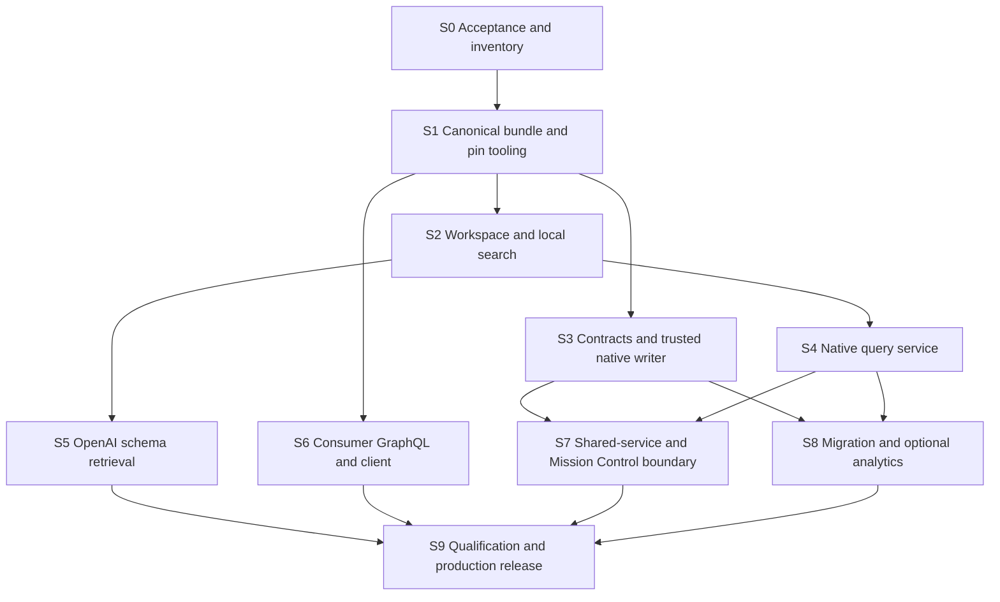

# Implementation plan and release gates

This plan is ready for an implementation team. Its S0–S9 IDs are local work packages, not new canonical issue IDs. No arbitrary calendar estimates are attached. [The specification](SPECIFICATION.md) defines behavior; [the ledger](DECISIONS.md) settles owner choices; [skills](AGENT-SKILLS.md) are release deliverables.

## 1. Sequence and parallel ownership



Assign one schema/release owner for S0–S1, one workspace/retrieval owner for S2/S5, one native contracts/executor owner for S3, one read/integration owner for S4/S7, one consumer API owner for S6, and one migration/qualification owner for S8/S9. These are roles, not a requirement for six simultaneous agents. Use file ownership boundaries; no two agents independently change contracts/IR. Skills evolve alongside each capability, with one integration editor owning routing/compatibility manifests.

Publish a small interface checkpoint after S1: release manifest, IR/rule fields, proposed v2 JSON Schemas, query artifact/receipt shape, capability handshake and error codes. S2/S3/S6 can then progress concurrently against immutable fixture bundles. S5 requires deterministic cards, not a live graph. Do not wait for shared-platform package extraction to build the native service.

## 2. Work packages

### S0 — Accept the baseline and establish actual state

Owner: schema/release. Inputs: current v2 candidate, this decision ledger and upstream schema ownership.

- Record baseline SDL/module/manifest/open-question hashes and source revisions. Verify module hashes/assembly, not only the final SDL hash.
- Publish decision dispositions upstream; resolve the small required source amendments and all vocab/ownership conflicts. Preserve historical reports. Audit Subjectable usage without arbitrary removals.
- Read-only inventory the real database: server/edition/language/APOC/index capability, labels/counts, legacy UID conflicts, actual stored property/enum shapes and available backup/restore path. Do not infer an empty graph or installed GDS.
- Inventory actual consumer operation documents/client repos and current endpoint auth. Record accepted users and required supported views. Do not recursively scan unrelated workspace/private material.
- Establish read, writer, migrator and analytics principal bindings and instance scopes; roles must be proven, not merely named in configuration.
- Reconcile this packet with the platform's Q01–Q04 clarifications: v2 selected; native typed + Cypher reads; governed intent writes; schema Vector Store selected; BFF selected; product vector search deferred. Link amendments without creating tracker issues.

Output: accepted release source baseline, capability/data inventory, approved migration disposition rules and documented release scope. Exit: no undecided modeling/policy option remains for included capabilities; factual unknowns have explicit handling. Source access gaps remain typed capability limits.

### S1 — Build the canonical release and pin mechanism

Owner: schema/release. Change upstream authoring sources and this repo's release tooling, `packages/schema-workspace/src/{load,parse,ir,sidecars}.ts`, `schema/sidecars`, generator scripts and contracts.

- Create a complete release manifest with immutable source revision; assemble modules deterministically.
- Generate validation params, node/edge permissions, UID tokens, predicate endpoints, qualifier grammar, assessment vocabulary, DDL and query-catalog metadata.
- Add an explicit repin command (proposed `pnpm schema:pin -- --release <manifest>`) that validates all hashes, updates PIN as one bundle and records provenance. Never edit pinned SDL manually.
- Remove hardcoded old SDL filenames from parser, loader, renderer, API printer, Docker build and tests; explicit invalid override fails closed.
- Build edition/capability-specific DDL plans; marker/fence/identity constraints are mandatory. Fail if required invariants cannot be enforced on the deployment target; optimization-only unavailable indexes are explicit.
- Re-key all sidecars, fixtures' registry IDs and catalog aliases to v2. Generate assessment/qualifier registries. Reconcile all predicates/registrars and 454 question statuses from actual evidence.
- Establish cross-language canonicalization golden vectors, including Unicode, zero/negative zero, decimals, large integers, null, sets versus arrays and timestamp precision. Preserve v1 decoding.

Exit: assembled source and manifest match; zero registry/SDL/IR/sidecar drift; all 160 decisions and seven unmapped edges have migration/validation ownership; Node/Python YAML/JSON conformance passes; required DDL succeeds on a disposable version-matched Neo4j. Produce an immutable candidate release bundle for other teams.

### S2 — Upgrade workspace, local search and traversal

Owner: workspace. Change `packages/schema-workspace`, schema task/terminology sidecars, `packages/contracts/src/workspace.ts`, executor schema tools and schema skill.

- Preserve current cards/rules/raw SDL/slices and add module/predicate/assessment/pattern cards and machine metadata.
- Implement structured filters, adjacency, bounded paths, evidence-aware task slices and field-level source links.
- Keep ordinary filesystem workflows first-class. Provide PowerShell and POSIX examples; replace “never ls/cat” and absolute page limits.
- Improve actual-file integrity verification and safe staged materialization. Bundle the same release for offline sandbox and online schema tools.
- Version the schema-context artifact: task/question IDs, selected card IDs/digests, chosen read/write route, scope and omissions. This artifact informs planning but grants no authority.

Exit: all old navigation capabilities have a v2 equivalent or explicit migration alias; stale metadata/tampered cards detected; zero broken links; deterministic clean rebuild; scoped graph traversal never invents an instance path; bounded slice retains required rules.

### S3 — Deliver contracts v2 and repair native apply

Owner: executor. Change `packages/contracts/src/{ingest,read,common,digest}.ts`, JSON exports, Python client, `packages/kg-ops/{schema-access,plan,apply,resolve,operations}`, HTTP/MCP handlers.

- Implement migration P1–P21 and the decision ledger's evidence/identity/temporal rules; accept predicate-only relations and full evidence chain without notes-only loss.
- Make release/policy pins, trusted evidence references and snapshot/create-only basis explicit. Creation-only proposals declare why no prior snapshot exists and still undergo identity/negative-slot checks.
- Store compiler-owned immutable plans and accept plan references at apply. Reject modified statement lists even with a recomputed hash. Never accept caller-declared verdicts as trusted verification.
- Introduce database writer fence and scoped effect markers with required uniqueness. Bind frozen clock/observations/executor/rules. Remove `onStale: proceed` from production.
- Correct duplicate lookup, changed-plan conflict, failed-marker history and ambiguous-commit recovery. Failure recording must not overwrite successful effects. One graph transaction contains canonical writes/marker/receipt/revision.
- Enforce operation-specific service auth; raw-write baseline tools absent from default HTTP/MCP/CLI agent capabilities. Secrets remain host-side. Read-only database credentials are independently tested.
- Implement complete paginated effect verification and receipt lookup, not only suggested cards for the first 20 affected nodes.

Exit: real disposable Neo4j tests prove same-context deterministic plan, forged-plan refusal, identical replay, changed-byte/plan conflict, concurrent identical apply, concurrent identifier/exclusive-slot conflict, graph revision drift, response lost after commit, failed retry without marker deletion, failure-recorder race, denied caller adjudication, dependency-aware partial apply and complete rollback. Every supported proposal and P1–P21 feature has a meaningful fixture.

### S4 — Promote native query artifacts into supported reads

Owner: reads. Change `packages/contracts/src/read.ts`/new Cypher-read contract, `packages/kg-ops/src/{read,cypher,resolve,neo4j}`, query templates, client/transports and query skill.

- Keep typed convenient reads and add parameterized single-statement Cypher artifacts with versioned parser/policy support. Start with tested Cypher 5 syntax; reject unsupported constructs explicitly.
- Validate release/binding, identifiers/relationship directions/procedures, parameter/output schema, limits and actual database read-only authority. Enforce visibility through intermediate traversals, filters, aggregates and outputs; restrict unprovable mixed scopes to audited templates. Do not rely on a regex filter.
- Implement streaming bounds/deadlines and byte/nesting caps, including nested collected values. Supported templates avoid unbounded aggregates; expensive analytics routes separately.
- Separate semantic result digest from timing/receipt metadata. Preserve immutable snapshots and truthful `observed`/`stable_revision` behavior. Upgrade trace patterns to HAS_EVIDENCE/ASSESSES/Activity.runId.
- Validate all final patterns and add result assertions on fixtures; include inverse-edge and predicate-only paths, temporal views, status non-implications and absence coverage.

Exit: typed and native routes answer the same supported gold questions; zero forbidden procedures/writes or cross-scope/property/span leaks; empty/failed/truncated differ; scalar serialization round-trips; changed graph invalidates stable preflight; forced transient retry discards all abandoned-attempt accumulators; all accepted catalog questions have truthful tested coverage. If parser/role support is absent, do not silently fall back to ungoverned Cypher.

### S5 — Build and qualify OpenAI schema retrieval

Owner: workspace/retrieval. Add adapter/export/index-generation modules in the schema-workspace service boundary, contracts and semantic skill reference. Use the existing `OPENAI_API_KEY` only through server-side configuration.

- Export only approved generated schema documents and manifest; implement resumable upload/poll/check/publish generation flow.
- Implement attribute-filtered direct search, local ID/digest rehydration, lexical fusion, cache and outage fallback.
- Pin SDK/configuration and record provider metadata without inventing control over hosted embedding model/dimensions.
- Add corpus generation receipts, exact file mapping, usage budgets, retirement/cleanup and no-partial-generation serving.
- Run a bounded live provider proof after local tests: index one complete accepted schema generation, execute the frozen query set, verify cards and usage, retain generation ref outside source commits. No production graph content is uploaded.

Exit: all required files indexed; stale/cross-release/unrecognized hits rejected; quota/timeout failure preserves lexical route; semantic-only failure is explicit; evaluation selects default hybrid routing with measurable value. Zero leaked secret/private content. An API key existing is not sufficient proof of endpoint access or index readiness.

### S6 — Optimize and qualify consumer GraphQL

Owner: consumer API. Change `apps/graphql-api/src/{server,limits,print-schema}`, packaging/Fly config, product projection/build manifest and a domain-owned generated-client package.

- Remove old SDL fallback and startup DDL. Implement fingerprints and graph-release readiness; source projection and runtime/print builder are identical.
- Apply accepted schema levers, deprecation migration and supported operation safelist. Generate strict typed client for web/Expo from executable API, not source SDL.
- Implement BFF-to-domain authenticated actor context and visibility policy. Trace/count/filter/aggregate paths cannot reveal excluded records. User/private data remains product-owned.
- Bound unions, aliases, input recursion, scalar lists, offsets, variable defaults and output bytes. Inspect actual generated Cypher and library limit behavior.
- Add indexes only through S1/S8 migration paths. Capture query plans/DB hits and benchmark cold/warm builds, RSS, p50/p95/p99 and concurrency.
- Keep product vector query capability unavailable in this release. Update stale 55 MB/30-second/4 GiB guidance only with new measurements.

Exit: every safelisted operation validates and runs on v2 fixtures; unauthorized/unknown/oversized operations rejected; no GraphQL mutations; all bounds adversarially tested; codegen/client compatibility; specification performance targets pass; no resource downsizing without soak evidence.

### S7 — Publish the shared boundary and Mission Control adapter

Owner: integration. Biotech application handler/client owns native execution. Shared KS gets portable envelopes and adapter tests through its published boundary; Mission Control's optional integration binds external capabilities.

- Implement describe/availability, query, plan/apply, receipt and verify-result mapping to `mc.knowledge_request.v1`/logical knowledge interfaces. Keep wrapper/native digests separate and preserve bytes/casing.
- Register exact contracts, schema/skill/policy digests, endpoint audience, read/write scopes, limits, partial policy and receipt semantics in capability catalog.
- Deliver sealed verification results through stable native effect identities; shared PostgreSQL outbox and Neo4j apply reconcile independently. Implement signed apply witnesses and the specification's bounded in-flight lease, local revocation fence and authoritative current-serving checks; qualify revocation races without claiming cross-store atomicity.
- Mount read-only digest-bound workspace/context assets in agent lanes; use short-lived scoped service tokens, no database passwords. Replace duplicate legacy schema source with selected release only after read parity.
- Contract-test AI Engineer's existing adapter shapes without changing its schema authority or requiring Neo4j fields. Common unsupported semantics are explicit.

Exit: standalone and Mission Control-correlated operation proofs; lost response after graph commit reconciles one effect; completed verification with held projection is not a successful write; cancellation/expired grants preserve historical receipt while preventing new effects; no domain imports in common kernel.

### S8 — Migrate graph data and qualify optional analytics

Owner: migration. Core migration is mandatory; AGA/data-vector serving is capability-gated and may remain unavailable without blocking the core release.

- Inventory all actual legacy labels/edges/properties and compare to migration notes. Resolve the seven unmapped relationship classes using this ledger; retain quarantined source data.
- Create a separate staging/shadow graph from a verified backup/export. Never assume an in-place rename is sufficient for Assertion/Assessment/Source/episode remodels.
- Produce migration intent/manifests with source/target release, input counts/digests, UID maps, property/enum transformations, temporal/provenance handling, checkpoint/restart identity, expected invariants and quarantine counts. Operator migration may batch; it does not pretend the whole migration is one fact transaction.
- Apply required DDL, migrate, replay/rerun supported fixtures and reconcile every record/edge. All required constraints/indexes are ONLINE. Confirm no contradictory active exclusive episodes, duplicate identifiers or orphan evidence.
- If native chunk vectors are included, implement selected model/index generation, source/chunker provenance, outbox/reconciliation and retrieval-eligibility checks; otherwise advertise unavailable. Schema semantic retrieval does not depend on this step.
- For analytical capability, use AGA/GDS only after feature/budget admission. Stream derived results to artifacts; canonical projection uses its own trusted typed writer and authoritative inputs. Test timeout/cancellation/resource cleanup and prediction-versus-fact separation.

Exit: migration accounting complete, supported-question replay correct, restore tested, old graph retained, no guessed identity/evidence. Optional analytics/vector routes either pass separate qualification or remain explicitly disabled.

### S9 — Integrated qualification, cutover and handoff

Owner: release. Requires S1–S7 and core S8. Publish compatible API/executor/workspace/rules/query/skill bundle as one release manifest; components may deploy independently only within declared compatibility.

1. Freeze writes through all canonical writers/migrators. Finish/reconcile in-flight effects; capture a final backup and delta since rehearsal. Verify backup restore and target counts.
2. Apply final delta to shadow graph, verify release marker/invariants/question results and required indexes. Keep old graph read-only for rollback. No destructive legacy cleanup in this release.
3. Deploy matching executor and GraphQL image to staging/canary. Use `bash scripts/fly.sh` from this repository for Fly. Smoke-test real database reads, auth, digest readiness, query bounds and native receipt lookup.
4. Switch trusted graph/endpoint bindings and compatible BFF client operation registry; publish workspace/skill/capability and semantic-generation pointers. Every consumer performs its release handshake.
5. Enable v2 writes only after read verification. Run one authorized small end-to-end v2 ingestion/evidence/readback proof, then duplicate/receipt recovery proof. This is the scoped Biotech release proof, not the platform's two final application fixtures.
6. Observe query latency/RSS/errors, stale/mismatch rates, write conflicts, marker recovery, index state and semantic degradation. Retain rollback material through the acceptance window.
7. Record deployment URLs, image/ref digests, graph release/backup IDs, test/evaluation report refs, index generation, known disabled capabilities and operator runbook. Runtime receipts/credentials stay in protected custody, not Git.

Rollback before new v2 writes: switch endpoint/graph/client/skill/index pointers together to the verified old release. Rollback after v2 writes: freeze/reconcile first; prefer forward repair on v2. Switching to the old graph requires replay/export of all committed v2 effects through an explicitly validated reverse mapping, or restore plus accepted data-loss recovery policy. **An old API image alone is not data rollback.** Never discard committed effects to make a canary appear successful.

Exit: live readiness reports the accepted v2 release, deployed API executable/operations match the typed client, the workspace pin matches the native service, canonical data migration is attested, and read/write/receipt proofs succeed. Update upstream acceptance and deployment docs with evidence; don't infer completion from a Git tag.

## 3. Evaluation and test matrix

| Surface | Meaningful release evidence |
| --- | --- |
| Schema/build | Hash/module tamper, missing override, wrong release rules, bad predicate endpoints, YAML parity, deterministic generation, on-disk workspace tamper |
| Search | Exact names, synonyms, domain terminology, reverse edges, enum/predicate distinction, stale semantic generation, provider outage, bounded slice with retained write rules |
| Native reads | Parameter binding, real read role, cross-scope/property/span denial, forbidden procedure/subquery, high fanout, nested lists, timeout/bytes, stable revision change, transient retry reset, null/integer/time serialization, historical/unknown evidence |
| Native writes | All supported v2 proposals, forged plan/snapshot/verdict, duplicate/conflict, concurrent identity/episode races, uncertain commit, failure-marker race, revocation, dependency-safe partial apply |
| Consumer API | Real operation documents, auth/visibility in filters/counts, safelist, unions/aliases/fragments/default variables, deadlines/output size, generated Cypher/index plans, pagination ties |
| Cross-service | Native bytes/digests preserved, no distributed-transaction assumption, admission-witness expiry/revocation races, delivery pending/applied/unresolved, lost-response reconciliation, explicit unsupported semantics |
| Skills | Correct capability routing, selected vendor overlay/version, executable examples, ambiguity/unknown/held handling, no raw-write escape, complete readback |
| Migration | Every input accounted, history retained, all supported questions answer correctly, restore rehearsal, safe cutover/rollback after writes |

Use the current eval harness as a starting point, not a certification: no baseline run was recorded at inspection. Freeze at least 60 schema-discovery tasks (cover all 14 modules, exact/paraphrase/cross-domain/negative), 30 native read tasks and 30 write/recovery tasks. Include all critical migration/question fixtures beyond these minima. Compare filesystem-only, structured CLI, hybrid search; typed versus typed+native reads; targeted Neo4j skill enrichment versus first-party-only. Same model/settings/data/budgets per paired run. Gold annotations come from accepted schema/evidence, never prompt-visible evaluation labels.

Gates: 100% pin-valid citations and exact-ID lookups; zero authority/invariant bypasses; no lost provenance or unexplained identity duplication; >=95% discovery Recall@10 on labeled supported tasks; >=90% end-to-end supported-task success, and zero failures on critical provenance/admission/recovery cases. Report bootstrap confidence intervals and per-domain failures; averages do not waive hard gates. Hybrid must either improve paraphrase recall by >=5 percentage points or reduce median discovery tokens by >=15% without task-quality regression; otherwise keep lexical default while retaining qualified semantic-on-demand. Report paid usage and p95; do not promise semantic retrieval is always faster.

## 4. Commands and evidence status

Existing repository commands, to run during implementation from this repository:

```powershell
pnpm build
pnpm test
pnpm contracts:json-schema
pnpm workspace:build
pnpm workspace:verify
bash scripts/neo4j-test.sh up
$env:BKS_INTEGRATION='1'
$env:NEO4J_TEST_URI='neo4j://localhost:7690'
$env:NEO4J_TEST_PASSWORD='bks-test-password'
pnpm exec vitest run --project kg-ops
```

Add explicit scripts for release validation, pattern/fixture validation, role/adversarial read proofs, migration rehearsal, search/agent evals, GraphQL benchmarks and transport conformance as their packages land. Run dependency/Git commands only from the owning repository; inspect its AGENTS.md before changes. No commits/pushes without the user's request.

For this documentation task: source and official documentation inspected, candidate/hash identity checked, and document link/decision coverage validated. Runtime tests, provider uploads, live DB inventory, migration, benchmarks and deployment are **not run**. The packet is complete planning input; those release gates remain implementation work.
