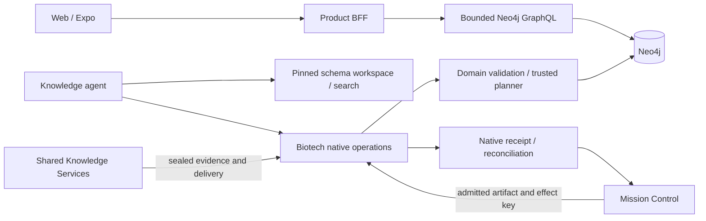

# Schema v2, workspace search and native knowledge operations

Status: selected implementation direction, 2026-10-11. MUST denotes release requirements; proposed command and contract names below are targets, not claims that they already exist. See [the plan](IMPLEMENTATION.md) for delivery gates and [the decision ledger](DECISIONS.md) for all synthesis questions.

## 1. Architectural decisions

### 1.1 Four owners, two database implementations

| Owner | Owns | Does not own |
| --- | --- | --- |
| Biotech Knowledge Services | Canonical graph contract, identity, evidence meaning, schema workspace, Cypher reads/planner/writer, GraphQL product API, domain skills | Mission scheduling or a second shared verification engine |
| Shared Knowledge Services | Acquisition, preparation, verification machinery, retrieval infrastructure, operation envelopes, custody, evaluation and delivery primitives | A universal SQL/Cypher query language or Biotech ontology |
| Mission Control | Mission/run/attempt lifecycle, capability bindings, grants, budgets, immutable artifact references, effect dispatch and reconciliation, acceptance | Graph mutation semantics or scientific truth |
| Product application/BFF | User sessions, entitlements, saved work, screen composition, consumer operation selection | Direct canonical ingestion or service credentials shipped to clients |

Keep `platform/knowledge-services/packages/knowledge-db` and its AI Engineer database bindings intact while extracting interfaces. Build the Neo4j adapter here. A common operation can preserve an opaque, versioned native payload; it does not need backend-equivalent internals. Cross-repository integration uses published HTTP/SDK/MCP/CLI contracts. No Mission Control kernel import may reach this repository or branch on `biotech`.



### 1.2 Search choice

Use **both filesystem tools and a small schema-aware executable**, extending `bks-schema`. `rg` is excellent for exact names and exploratory text. It cannot validate endpoint compatibility, distinguish predicate-only facts from stored relationships, expand inheritance, select an evidence path, or enforce a slice budget. Those are real functions for the executable. Do not build a new proprietary general-purpose grep or a new search-language parser.

Use **OpenAI Vector Stores as an optional-at-runtime, required-to-qualify semantic discovery channel** over schema documentation. Hosted search supplies candidates; the pinned local bundle supplies truth. The v2 release must demonstrate semantic indexing/search, but an outage must degrade to complete local navigation rather than block database operations. This is separate from embedding scientific source chunks in Neo4j.

### 1.3 Native artifacts

Support parameterized **Cypher read artifacts** for complex agent questions alongside existing typed reads and versioned templates. Do not force every traversal into an ever-growing DSL. Frequently used reads may graduate into templates after measurement.

Canonical writes remain **typed Biotech ingestion intents**. Agents can inspect compiled Cypher and reason with the Neo4j skills, but cannot supply executable plan statements to the production apply endpoint. Fixed query text is only one part of deterministic execution; schema validation, identity, evidence admission, temporal closure, concurrency and receipt recovery are also required. Raw write scripts belong to a separately admitted migration/operator lane or disposable evaluation.

## 2. Canonical schema release

### 2.1 Baseline and accepted policy

The chosen baseline is `schema/program/final/schema/final_biotech_schema_v2.graphql`, SHA-256 `c7cf1235dba876b26460c54a6510028d2dcfc65989787eacd5b446f9034b4793`. Its assembly manifest agrees. The old runtime pin remains `8313a6f83a2429fffdc9ce6cbdb03cc2808c7b06022040a1e4f36cd2720ae3eb` at inspection time.

Accept the 69-node/106-relationship design and existing rulings except where [DECISIONS](DECISIONS.md) explicitly amends them. Accept L1 aggregate-filter suppression and L2 no GraphQL mutations. Executor creatability comes from `mutations.executor`, never GraphQL directives. Adopt all five deprecated-field exclusions in the product build after migrating supported operation documents.

Explicitly replace the old expanded-pair acceptance budget with **collapsed semantic pairs <=600**; continue publishing expanded counts. The reported expanded 848 does not satisfy the old <=600 metric, and must never be described as doing so. Retain the useful interface relationships instead of deleting meaning to improve that count. Use expanded 848 as the initial regression baseline, and require a question/fixture and measured API cost for each increase. Accept K's 15 relationship types as a recorded one-type exception. Full API generation and runtime measurements remain hard gates.

### 2.2 One upstream release bundle

Promote the accepted source to a versioned directory under `biotech-meta/docs/schema` with a release manifest. Preserve this program's candidate/runlogs as design provenance. Upstream owns editable modules, node/relationship registers, vocabulary rules, identity/projection rules, query templates and migration mappings. Generate assembled SDL, validation parameters, operational DDL and derived indexes from those sources. Pin immutable copies here with exact source revision and per-file digests.

Required release contents:

| Artifact | Required contents |
| --- | --- |
| `release.json` | Release ID, parent baseline, exact files/digests, module ownership, contract/compiler versions, supported Neo4j/Cypher/APOC matrix, decision-ledger digest |
| SDL/modules | Kernel + D1–D13; source locations preserved; docstrings repaired to accepted vocabulary |
| Node/relationship registers | All types, stable UID tokens, primary/storage labels, executor operation permissions, class, temporal/exclusivity scope, projection gate and provenance requirements |
| Vocabulary bundle | Predicates with allowed subject/object/literal forms; qualifiers and value grammars; assessment subkinds/facets; identifiers, targets, lifecycle, verdict/admission rules, forbidden implications |
| DDL | Community-compatible required constraints/indexes; separately capability-gated Enterprise additions; stable names and expected definitions; migration/check commands |
| Query catalog | Named templates, parameters/outputs, version/language, limits, question IDs, temporal/evidence semantics and required indexes |
| Migration map | Every legacy node/relationship/property/enum disposition, transformation, retained history and quarantine policy |
| Workspace inputs | Domain mapping, aliases, task routes, identity/ingestion guidance and source references |

`PIN.json` MUST identify the selected SDL by manifest key, not hardcoded `final_biotech_schema_proposal.graphql`. Verify actual bytes for **all** pinned files on load/build. An explicitly supplied missing `BKS_SCHEMA_PATH` is an error, never fallback. Production starts only from the image's release bundle; local overrides must be explicit and visibly non-production.

### 2.3 Distinct release identities

Publish independently: source `schemaDigest`; complete `schemaReleaseDigest` including executable rules/registers; `workspaceFingerprint`; `queryCatalogDigest`; `productProjectionDigest`; `executableGraphqlDigest`; `operationRegistryDigest`; executor/skill bundle versions; deployed database migration/release ID; semantic-index generation. Equality is required only where meaningful. The same SDL with different identity rules is a different operational release.

The graph records an executor-owned installed-release marker after required DDL and migration checks pass. API and executor readiness compare it with their accepted compatibility matrix. A successful GraphQL build or connectivity check does not attest migrated data. Reject writes on a rules/schema mismatch; return a typed mismatch for reads unless an explicitly supported read-compatibility release applies.

### 2.4 Source corrections before freezing v2

Most decisions are rules, fixtures and tooling, not new ontology. Keep OD-10's no-SDL-change predicate solution. Required source amendments are the qualifier/predicate docstring corrections and provenance stamps for retained `DecisionCriterion.publisherUid` (or remove that cache from the public projection until the stamps exist). Emit missing assessment/qualifier registries. Reconcile conflicting predicate names and relationship classes before regenerating IR. Any amendment changes the release digest and reruns generation/qualification; the candidate hash is not reused as the final hash.

## 3. Workspace v2

### 3.1 Generated, accessible files

Retain every useful current layer: START_HERE, index, domain pages, cards, vocabularies, rules, raw per-definition SDL, tasks, schema IR, manifest, search and slices. Re-map W-fragment assumptions to K/D1–D13 through explicit module metadata, not banner-name guessing. Preserve old IDs as documented navigation aliases where meaningful; removed concepts point to a migration explanation, not a silently substituted type.

Extend the tree:

```text
workspace/
  START_HERE.md                 # workflow, pin, limits and tool routes
  INDEX.md
  manifest.json
  domains/  modules/  tasks/
  nodes/  relationships/  edge-properties/  interfaces/  unions/
  predicates/                  # predicate-only and FIELD assertions included
  assessments/                 # kind/subkind/facets and admissible subjects
  vocabularies/  rules/  sdl/
  patterns/                    # question-linked Cypher and output contracts
  migrations/                  # v1 -> v2 navigation, never execution scripts
  search/index.jsonl           # filterable records, one card per row
  search/adjacency.json        # schema topology, not graph-instance data
  schema-ir.json
```

Each card has generated front matter (`id`, `kind`, `module`, `schemaReleaseDigest`, `sourceRefs`, `aliases`, `capabilities`, `cardDigest`) and a readable body. Compute `cardDigest` over the canonical body/front matter excluding its own digest. JSON/JSONL is the machine authority for filters; front matter is a convenience projection from the same IR, never separately maintained.

Node cards show identity, stored labels, fields, legal predicates, incoming/outgoing relationships, evidence path, read patterns, allowed proposals, forbidden implications and source definition locations. Relationship cards separate stored direction from inverse GraphQL fields and expand interface/union targets only on request. Predicate cards explain whether a fact has a typed edge or only an Assertion. Display both valid-time and recorded-time rules and explicit exclusivity scope.

### 3.2 Command contract

The following additions are **to implement**; preserve existing `search`, `get`, `slice`, `map`, `manifest` compatibility:

| Command | Result |
| --- | --- |
| `bks-schema search "..." --mode hybrid --kind predicate --module D6 --json` (modes: lexical, semantic, hybrid) | Ranked IDs, paths, match reasons, release/card digests, retriever mode/degradation and bounded snippets |
| `bks-schema find --kind node --property uid --executor-op node.upsert --json` | Exact structured matches, deterministic ordering |
| `bks-schema neighbors node:LabelVersion --direction both --depth 1 --json` | Schema adjacency with edge direction/class/endpoint conditions |
| `bks-schema path node:Product node:SourceLocator --max-hops 5 --limit 5 --json` | Legal schema paths and evidence/predicate joins; not proof the live graph contains the path |
| `bks-schema pattern --question Q-D6-01 --json` | Validated query template, parameters, result schema and temporal/provenance notes |
| `bks-schema slice --tasks ingest-product-label --max-tokens 12000 --out <scratch>` | Digest-bound context, selected elements and closure/omissions with reasons |
| `bks-schema doctor --json` | Bundle integrity, unsupported version, broken links, semantic generation compatibility; no secret output |

Initial limits: search top 10/max 50; traversal depth default 1/max 5; adjacency 100 nodes/250 arcs; at most five returned paths; slice target 12,000 tokens with explicit estimates and truncation. These are versioned policy defaults, tested against task coverage; callers may request a larger admitted budget. Never truncate identity/admission rules out of a write slice silently. Distinguish a bounded agent context from a compileable SDL slice; mark incomplete closure and refuse to label it compileable.

Exact ID/name/alias lookup precedes fuzzy ranking. Lexical search keeps deterministic ties and adds kind/module/field/predicate filters. A later BM25 implementation is justified only if the comparison shows benefit; existing token ranking is a valid starting point. Semantic scores are not schema validity. `get` rehydrates authoritative local content and supports field/section selection.

Teach ordinary filesystem alternatives, e.g. `rg --files workspace/nodes`, `rg -n 'HAS_EVIDENCE|SourceLocator' workspace/patterns workspace/rules`, and PowerShell `Get-Content`/`ConvertFrom-Json` or `jq` over the JSONL index. Allow scoped reads and directory enumeration. Replace the current absolute four-page rule with a context budget and measured progressive disclosure.

### 3.3 Integrity and usability gates

`workspace:verify` MUST hash actual on-disk content, not merely compare the stored manifest fingerprint with a regenerated fingerprint. Detect missing, altered and unexpected generated files. Build reproducibly from a frozen generation timestamp outside semantic fingerprints; test clean-room rerender, source references and all links. Write to a staging directory and atomically replace only the owned generated output after path validation. Skills/examples are tested against the packaged workspace, not the author's checkout.

## 4. Semantic schema discovery with OpenAI Vector Stores

### 4.1 Corpus and provider contract

Index **generated schema cards, task routes, predicate/assessment rules and question-linked pattern explanations**. Exclude patient/private data, runtime receipts, captures, secrets, the entire source repository, redundant huge IR dumps and historical candidate variants. A separate approved-public-content export manifest enumerates the exact uploaded paths and digests. Split long cards into stable section documents sharing a parent card ID; every document embeds its own title, ID, module and release identity.

OpenAI's retrieval API supports direct Vector Store search, file-attribute filtering and ranked chunks. Indexing is asynchronous; deletions can remain visible briefly. File attributes are limited to 16 keys. Those properties motivate generation isolation and local validation. [Official retrieval guide](https://developers.openai.com/api/docs/guides/retrieval)

Use one store per immutable schema-index generation/environment, with an operational current-generation pointer. Initial attributes: `release_digest`, `workspace_fingerprint`, `card_id`, `card_digest`, `kind`, `module`, `language`, `corpus_kind` (eight keys; encode compact values within provider bounds). Keep file ID -> local path/section/digest mapping outside the provider. Managed Vector Store creation does not expose a user-selected embedding model/dimension in the documented create contract; do not pretend the Neo4j chunk embedding setting configures this service. Record actual API/SDK and indexing options, and provider-reported metadata when available. [Create contract](https://developers.openai.com/api/reference/resources/vector_stores/methods/create)

Initial indexing choice: deterministic documents targeting 400–1,200 tokens; static 800-token chunks/100-token overlap for longer text, then tune on frozen tasks. This is a project choice, not a claimed provider optimum. Store generation identity includes corpus manifest, renderer, chunking configuration and search configuration. An unchanged local document can reuse an uploaded file only when custody and provider ownership permit; deduplication never mixes release eligibility.

### 4.2 Build, search, fallback

1. Export and hash the approved corpus locally; report file/token estimates before upload in the implementation run.
2. Create candidate generation, upload files, attach attributes, poll until every required file succeeds; retain resumable progress and bounded retries. Partial indexing is not ready.
3. Run pinned task evaluation and exact round-trip file/card checks; atomically publish the generation pointer. Keep the previous generation for rollback.
4. Search only the bound store with an exact release filter, initial `max_num_results=20`, `rewrite_query=false`, and logged ranker/threshold settings. Direct search avoids an extra answer-generation call. [Search API](https://developers.openai.com/api/reference/resources/vector_stores/methods/search)
5. Merge local lexical top 20 with semantic top 20 by reciprocal-rank fusion (`k=60`, initial equal weights); exact ID/name matches stay first. Deduplicate by card/section; return top 10. These are tunable project defaults. Do not compare heterogeneous raw scores arithmetically.
6. Validate returned file IDs, attributes and card digests against the local generation mapping, then rehydrate local cards. Reject unknown/stale hits even if the provider returns them. No automatic execution of retrieved text.
7. Provider timeout, quota, unavailable generation or pin mismatch returns explicit lexical-only degradation. Caller requesting semantic-only receives an explicit unavailable status, never a false empty search.

Search cache keys include workspace/generation, normalized query, filters and ranking configuration. Runtime schema search uses server-side credentials; sandbox agents call an admitted search endpoint and never receive `OPENAI_API_KEY`. Local offline search requires no provider. Limit query length to 2,000 characters, hosted deadline to 5 seconds initially, and enforce configured spend/request ceilings. Do not upload or create stores during this planning task. The existing key enables later implementation validation, not a claim that a store already exists.

Do not mutate the active generation in place. Deactivate it before cleanup; delay deletion until rollback/custody retention expires. Track both file objects and store memberships to avoid accidental deletion of shared uploads. Measure storage and search usage rather than hardcoding provider prices into the release contract.

## 5. Consumer GraphQL API

### 5.1 Schema shaping and client access

Keep `@neo4j/graphql` and Apollo. Start from the lockfile-resolved 7.6.3-era implementation; select and pin upgrades only after compatibility tests. The input domain SDL is canonical; the executable consumer projection is a separately fingerprinted build from it. The projection may omit operational/private fields and costly unused entry points but cannot rename domain semantics silently.

Enable the five `excludeDeprecatedFields` options; retain `@filterable(byAggregate: false)` and `@mutation(operations: [])`. Disable scalar filters/sorting only where the supported operation inventory demonstrates no use. Generated schema reduction primarily improves startup and memory, not automatically query latency. [Neo4j optimization](https://neo4j.com/docs/graphql/current/optimization/)

Select **product BFF access** for web/Expo. BFF validates the existing application user session and entitlements, retains service credentials, and forwards a short-lived audience-bound actor context to the domain API. GraphQL verifies the BFF identity/context and applies visibility; a caller-supplied header is not trusted. Do not invent a new identity provider. The integration must bind to the application's actual configured issuer. Service API keys never enter browser/Expo bundles.

Start with a server-enforced persisted-operation safelist for entity card, paginated relationships, paginated evidence trace, label/version history, claim/report and identifier resolution views. Allow developer exploration only in a separate authenticated engineering profile. APQ caching alone is not safelisting. Generate a domain-owned TypeScript client from the exact executable schema and reviewed documents; pin strict scalar mappings, operation hashes, fragments and compatibility metadata. Consumer writes remain product/domain operations, not generated GraphQL mutations.

### 5.2 Bounds and execution

Retain parser/body/depth/cost/time controls, but repair admission so it reflects generated execution. Include variable defaults, aliases, fragments, recursive filter depth, input arrays, offsets, nested lists, union fields, counts/aggregates and scalar-list response bytes. `@limit` on a target does not prove every union relationship is bounded in the installed library. Use reviewed operation bounds and reject unsupported shapes before execution. Evaluate library `limitRequired`/complexity estimators only against the pinned executable; do not assume a current-doc feature exists in the installed version. [Neo4j bounded queries](https://neo4j.com/docs/graphql/current/security/avoid-unbounded-queries/)

Initial consumer limits: root page default 25/max 100; nested page max 25; depth 8; request 256 KiB; response 2 MiB; database timeout 5 seconds and end-to-end deadline 8 seconds. Aggregations have explicit cost classes and narrower operation-specific scope. These tighten existing defaults and are target release policy, not current behavior. Cursor interfaces must demonstrate actual pagination work/correctness; GraphQL connections do not by themselves imply keyset efficiency.

Use one long-lived driver, database explicitly selected, bounded pool/acquisition/retry time and reader credentials. Separate liveness from readiness; readiness includes release compatibility and required index state. DDL belongs in a migration job, never server startup. Replace `GRAPHQL_ENSURE_OPERATIONS` permissive startup with a production refusal if requested.

For every supported operation capture generated Cypher, EXPLAIN and isolated PROFILE; inspect index seeks, DB hits, Cartesian products, sorts, fanout, result bytes and p95 at representative data sizes. Static allowlisted labels are preferable for common UID lookups on 5.26; the existing dynamic-label pattern can scan all nodes. Add indexes justified by real patterns, including identifier keys and temporal/provenance lookups. Do not add DataLoader blindly around library-generated queries. Cache only authorized, versioned outputs with admission/revocation checks; prefer parsed-operation/schema caching before response caching.

Product data vector search is **not part of the first v2 consumer release**. Return unsupported explicitly; v2 has no `@vector` declaration. Semantic schema retrieval remains available to agents. Source-chunk vector indexing has its own native profile (OD-44), not implicit GraphQL enablement.

### 5.3 Performance acceptance

Prior synthesis measurements: 1.74 MB executable, 960 inputs, 1.46-second median in-process build; deprecated exclusions measured 0.73 MB/1.07 seconds. These are historical local measurements, not new runs or production SLOs.

Release gates: <=90 nodes, <=160 relationship types, <=4,000 generated input types, <=6 MB executable, median in-process build <5 seconds on recorded hardware. Target the measured lean configuration rather than merely passing those ceilings. Record cold container startup, peak build RSS, steady RSS, GC, query p50/p95/p99 and connection pressure separately.

Initial product objective: warm p95 <=300 ms entity card/identifier read and <=750 ms bounded evidence/history read at 20 concurrent clients on declared production-like data. Use these as acceptance targets, not promised observations; correct queries and refine indexes/resources if they fail. No >10% p95/RSS regression against the agreed v2 benchmark without a recorded explanation and new budget. Downsize Fly from its current documented 4 GiB only after a 30-minute representative soak and peak RSS below 70% of the proposed limit. Keep deployment rollback available.

## 6. Native reads

### 6.1 Supported artifacts

Maintain typed `biotech-knowledge-read-intent.v2` operations for resolve/card/list/neighbors/assertion/evidence/history/report/association reads. Add `biotech-cypher-read-intent.v1` with one Cypher statement, parameters and result schema. Both use the same authorization, budgets, snapshot serialization and receipt service. A named template is a resolved immutable Cypher artifact with typed parameters, not a third execution engine.

Required common fields: native contract version, intent ID, schema release/workspace/query-catalog digests, purpose, optional question IDs/context artifact, authorized binding reference, input artifact refs, limits and consistency request. The service derives effective actor/application/database grants from authenticated context. Native Cypher adds exact UTF-8 statement digest, language version, parameter schema, output columns/schema, permitted label/relationship/procedure scope and ordering policy. No arbitrary URI, credentials or provider configuration in the artifact.

Illustrative native payload (digest placeholders are not executable fixtures):

```json
{
  "schemaVersion": "biotech-cypher-read-intent.v1",
  "intentId": "inspect-label-01",
  "schemaReleaseDigest": "sha256:<release>",
  "workspaceFingerprint": "sha256:<workspace>",
  "purpose": "Inspect known label versions before proposing a new capture",
  "language": "CYPHER_5",
  "statement": "MATCH (p:Package {uid: $uid})-[:HAS_LABEL_VERSION]->(v:LabelVersion) RETURN v.uid AS uid ORDER BY uid LIMIT $limit",
  "parameters": {"uid": "hu:package:<opaque>", "limit": 25},
  "resultSchemaRef": "bks.read.label-version-uids.v1",
  "limits": {"rowCap": 25, "byteCap": 262144, "timeoutMs": 5000},
  "consistency": {"mode": "observed"}
}
```

Actual examples must be validated against the accepted release and live disposable fixtures; endpoints/direction are checked by the query catalog.

### 6.2 Enforcement and consistency

Use a version-compatible parser/policy adapter for a conservative accepted Cypher subset, EXPLAIN for server planning, and real database read-only authority. Disallow administration, writes, LOAD CSV, transactional subquery writes, arbitrary procedures, file/network extensions and provider side effects. Procedure permission requires an explicit pure/read allowlist. A missing compatible parser or enforceable database role means advanced arbitrary reads are unavailable; templates/typed reads still work. Regex and `session(READ)` are defense-in-depth/routing, not the security boundary. [Driver transaction documentation](https://neo4j.com/docs/javascript-manual/current/transactions/)

Read-only authority is not sufficient for visibility. Arbitrary reads are enabled only for scopes where database privileges and the accepted query subset enforce application/tenant, property, evidence and span-rights policy through intermediate traversals, predicates, aggregates and returned values. For mixed/restricted scopes without this proof, use audited templates; do not attempt unsafe text insertion of tenant predicates. Reject unrestricted full-node/`properties(n)` returns where property policy applies. Test cross-scope UID/identifier probing, existence/count inference, restricted-property filters and disallowed source-span projections. Returned artifact bytes remain access-checked too.

Bound traversal length, result rows including a one-row overflow probe, bytes, nesting, list values, execution time and concurrency. Stream/cancel at the execution boundary instead of fetching all records and slicing. A final LIMIT does not bound database work: enforce deadlines and constrain costly shapes. EXPLAIN is not a correctness or runtime-cost certificate. PROFILE executes and belongs in isolated benchmarks.

Neo4j's normal isolation is read committed; a bookmark is causal, not a frozen historical snapshot. [Concurrency manual](https://neo4j.com/docs/operations-manual/current/database-internals/concurrent-data-access/)

Expose two truthful modes: `observed` (retained result bytes at a stated read interval/bookmarks, no repeatable-snapshot claim), and `stable_revision` for ingestion preflight using the native writer fence in section 7. Both committed-revision probes and all dependency reads run within one explicit read transaction on one database member, with causal bookmarks for prior effects when requested. Reject/retry the entire read if the revision changes; never independently route probes. Every retry allocates fresh accumulators and discards all rows/bytes/touched references from the abandoned attempt. This guarantee requires every canonical writer/migrator to participate and excludes unmanaged admin writes. Re-running later is a new observation; historical replay reads retained snapshot bytes. World valid-time/recorded-time predicates remain independent.

Separate `queryDigest` (statement/template + canonical params + semantic pins), `resultDigest` (normalized ordered values/status/truncation), and `receiptDigest` (timing/bookmarks/server/execution metadata included). Declare array/set ordering, integers beyond JS safe range, UTC instants/date-only values, durations, spatial values, nulls and decimal serialization. Exclude elapsed milliseconds and request IDs from semantic result identity. Keep old v1 digest verification unchanged.

Return `ok`, `empty`, `truncated`, `failed`, `skipped`, `unsupported`, `stale`, or `forbidden` with typed reasons; none of the latter six means absence. Snapshots intended for ingestion must be persisted with issuer, scope, pins, read dependency metadata and bytes digest. The ingestion service verifies custody and digest, not just a model-provided string. Unknown identities stay ambiguous.

## 7. Native writes and evidence admission

### 7.1 Contract v2 and planner

Extend `packages/contracts`, exported JSON Schemas and Python models together. Support the existing useful proposal kinds plus `assertion.relate`, claim occurrence bindings, typed qualifiers, derivation/supersession, `assessment.record`, trusted adjudication delivery, report publication and separately privileged projection writes. Implement P1–P21 from the migration report. `mention.stage` produces a SourceLocator and RESOLUTION Assessment rather than the removed Mention node.

Registry validation covers primary/storage labels, executor permissions, UID tokens, property types, predicate subject/object/literal shape, qualifiers, asserter scope, identity uniqueness, temporal/exclusive slots and projection gates. Ordinary agents cannot write derived Association/MENTIONS caches or declare their own accepted adjudication. An `adjudication` proposal references a sealed authorized verification result; the executor hydrates it from trusted custody. Source evidence, capture fidelity, scientific support, admission and publication are distinct.

FIELD facts receive per-field assertions and locators even inside versioned state payloads. The attach assertion establishes membership/episode, not blanket proof for every property. Grouping of locators within an artifact is allowed; field-to-locator mapping must remain inspectable. Private-person data does not enter the shared scientific graph.

The planner is a pure compiler over normalized intent, complete release/rule set, frozen observations and injected planning clock. It emits proposal dispositions, dependency ordering, effects, invariant checks and parameterized Cypher. Remote captures/verifications happen before planning and are frozen inputs. Use versioned canonical JSON with cross-language golden vectors; distinguish raw artifact byte digest from canonical payload digest.

### 7.2 Plan authenticity, authority and retry

Production `apply` accepts immutable **server-issued planRef + expected planDigest**, native intent reference/digest, stable effect key and authorized partial policy. The stored plan binds original normalized intent, observations, clock, executor/rule versions, grants/admission witnesses and compiler output. A client-created hash is not proof the service compiled a plan. CLI offline drafts can be uploaded for validation/planning but cannot become executable by submitting statements. Recompilation is allowed only from the frozen context and must reproduce the approved digest.

Before planning/repeating an uncertain apply, look up the scoped effect marker/receipt. Completed identical intent+original plan returns its recorded result. Same identity with changed payload/plan conflicts. No implicit re-plan with a fresh clock on retry. Stale state yields an explicit new plan and renewed machine policy admission; human review is required only if the governing capability/policy calls for it. The owner's approved normal workflow is not interrupted by generic skill confirmation prose.

**External authority consistency:** custody, verification and grants may live outside Neo4j. Prefetch/verify immutable blobs before acquiring the writer fence. The domain admission service issues a signed, audience-bound, short-lived apply witness after checking the authoritative grant/evidence state. It binds actor/scope, effect, intent/plan/release/evidence digests, issuer policy/decision versions, issuance/expiry and revocation generation. Initial maximum lifetime is 60 seconds; sufficient lifetime must remain for the bounded apply deadline. Pin trusted issuers/keys and fail closed on unavailable required authority. Inside Neo4j validate that witness and any installed local revocation fence; do not hold a database transaction open across provider calls.

The selected guarantee is **authorization at witness issuance plus bounded in-flight lease**, not atomic immediate revocation across stores. External revocation prevents new witnesses; a previously issued still-valid witness may commit during the lease unless its revocation has already reached the local fence. Record the exact witness on the receipt. Current serving/publication rechecks authoritative eligibility and denies revoked effects even if retained in graph history; authority unavailable fails closed for official/restricted serving. Deliver revocation/projection invalidation durably and reconcile it; compensation is a new admitted action. Test revocation before witness, after witness/before commit, after commit, delayed revocation delivery and expired witness. Do not describe these semantics as instantaneous cross-database authorization.

### 7.3 Transaction and concurrency model

Start conservatively with a **database-scoped canonical writer fence** (`KsWriteFence`, executor-owned operational label). Every canonical mutation locks that fence through a dependent property update inside its single explicit transaction before validating graph preconditions. The committed monotonic `graphRevision` advances with graph effects and receipt. This serializes canonical writes across replicas and protects identity/exclusive-slot negative reads without pretending touched-node timestamps prevent phantoms. It is a native token, not a shared PostgreSQL knowledge sequence. Measure contention; later sharded slot locks require a separate proof, including cross-scope identity.

Required atomic transaction order:

1. Acquire writer fence and validate installed release/current effective authority.
2. Claim unique marker keyed by trusted installation/application/tenant + semantic effect identity; retain native intent ID and both digests. Scoped authorization is verified even for duplicate receipt access.
3. Recheck snapshot authenticity, graph revision or complete declared dependencies, required identity/episode preconditions, plan authenticity, admission-witness validity/expiry and installed local revocation state under the bounded-lease semantics above.
4. Execute compiler-owned statements; validate asserted-edge provenance, derived gates, exclusive temporal slots, global/domain UID and identifier uniqueness, and declared affected counts.
5. Write receipt projection, lineage and new revision, then commit once.

The first release uses strict stale failure; remove production `onStale: proceed`. Any future disjoint rebase must prove all dependencies including relationships/absence and produce a new admitted plan. Large jobs split into deterministic bounded child intents with parent manifest; the entire parent is not claimed atomic. Initial maximum 500 proposals/intent, further limited by plan size and a 30-second transaction budget.

Failed attempts never delete/recreate markers in a separate preflight write. Preserve attempt history and use a guarded transition under the apply lock. If a failure is definitively rolled back, the permitted failure-record transaction must not overwrite an already committed receipt from another attempt. A lost commit response is **unresolved**, not automatically failed; reconcile via marker with the original effect identity. Never issue a failure-marker upsert that can replace `applied`. Cancellation after commit reports the effect and retains recovery.

Only operational DDL may establish the marker/fence constraints. Domain Entity labels do not cover every v2 node, so UID lookup and uniqueness must not assume all nodes carry `:Entity`. Use release-validated token-to-primary-label routing; canonical writer fencing plus explicit UID conflict checks cover cross-label cases, with per-label constraints as a second defense.

### 7.4 Verification after apply

Receipt has effect scope, original intent/plan/releases, affected entities/relationships, proposal outcomes, invariant results, prior/next native revision, authority/admission refs and recovery identity. Preserve historical bytes. Readback covers **all** declared effects in pages and checks the expected predicates, episodes, evidence chain, derived gates and lineage; the current first-20-node card suggestion is insufficient. Verification success is separate from database commit and mission acceptance.

## 8. Shared services and Mission Control integration

Implement a narrow domain adapter protocol: `describe`, `schema.search/get/slice`, `resolve/read`, `plan`, `apply`, `receipt.get`, `verifyResult`; separately advertise `retrieve` and analytics when available. `describe` reports contract versions, native consistency/recovery guarantees, supported proposal kinds and actual deployment capabilities. It must not advertise a planned operation as available.

A shared envelope carries authenticated scope, correlation, capability binding, native contract/digest algorithm, immutable payload ref/digest, semantic effect key, budgets, schema/rules/policy pins and partial-result policy. Payload bytes stay native; Python must not rename camelCase fields or recompute a different canonicalization. AI Engineer continues its SQL/query-catalog/temporal-head semantics; Biotech returns graph-native IDs and observations. Common tests check guarantees, not identical database representation.

Mission Control's `mc.knowledge_request.v1` and logical `knowledge.*` interfaces are **specified**, but the inspected current kernel/integration has no implemented general writer/receipt adapter. Its optional Biotech integration already contains schema-grounding/read logic; reuse its external adapter/capability seams and retire duplicate schema authority after parity. Do not infer implementation from the existing boundary ADR.

The mission records dispatch/effect intent before invoking the service, retains intent/read/plan/receipt artifact references and settles its own operation only after receipt reconciliation. Neo4j and PostgreSQL do not share a transaction. Shared verification completion and domain delivery have separate states: `pending`, `applied`, `rejected`, `unresolved`. Standalone operations are legal and do not mint fictitious missions. One graph Activity per actual Mission Control run aggregates operation/intent/plan/receipt IDs; standalone execution uses a clearly namespaced native execution run.

Use app-scoped existing Supabase `knowledge-artifacts` custody for immutable captures/plans/receipts with access-checked references; `mission-artifacts` stores mission-owned artifacts/references. Blob availability and digest are checked before applying evidence-dependent effects. No secret, storage signed URL or unrestricted DB credential is mounted in an agent workspace.

The pre-sprint deliverable is the working Biotech service plus a published, contract-tested adapter boundary and Mission Control receipt/recovery proof. Moving all shared algorithms/packages, implementing every application mode and running both full application fixtures belongs to the subsequent platform sprint. Preserve that sprint's final-fixture gate; run the targeted Biotech release/component proofs here.
